# AuraCash — Sistema Web de Gestão Financeira

O **AuraCash** é um projeto acadêmico desenvolvido em equipe em 2025, com a proposta de facilitar a organização e o planejamento das finanças pessoais por meio de uma plataforma web.

A aplicação permite acompanhar receitas e despesas, organizar metas financeiras e visualizar informações por meio de um dashboard, contribuindo para uma gestão financeira mais prática e organizada.

## Funcionalidades

- Cadastro e gerenciamento de receitas e despesas;
- Organização de categorias financeiras;
- Criação e acompanhamento de metas;
- Dashboard para visualização de informações financeiras;
- Gerenciamento de contas compartilhadas;
- Geração de relatórios financeiros.

## Tecnologias utilizadas

- **Frontend:** HTML, CSS e JavaScript;
- **Backend:** Node.js e Express;
- **Banco de dados:** MySQL;
- **Outras ferramentas:** APIs e ferramentas de inteligência artificial como apoio ao desenvolvimento.

## Minha participação

No desenvolvimento do AuraCash, fui responsável pela elaboração de mockups e wireframes, utilizados como referência para a estrutura e a interface da aplicação. Também participei do desenvolvimento colaborativo do sistema, utilizando ferramentas de inteligência artificial como apoio à implementação de funcionalidades e interfaces.

## Objetivo do projeto

Aplicar conhecimentos de desenvolvimento web, prototipação de interfaces, integração entre frontend e backend e gerenciamento de dados na construção de uma solução voltada à organização financeira pessoal.

## Status do projeto

*Projeto acadêmico desenvolvido em equipe.*

O sistema chegou a ser hospedado temporariamente na plataforma Railway. Atualmente, não está disponível para acesso online e apresenta algumas limitações, especialmente em determinados relatórios financeiros. O banco de dados não está incluído neste repositório.

## 📸 Telas do projeto

### 1. Login

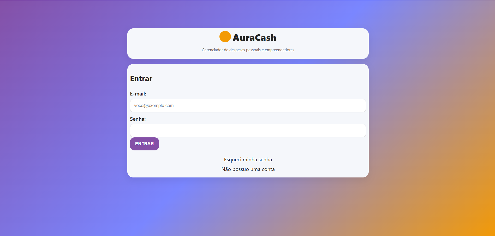

### 2. Cadastro

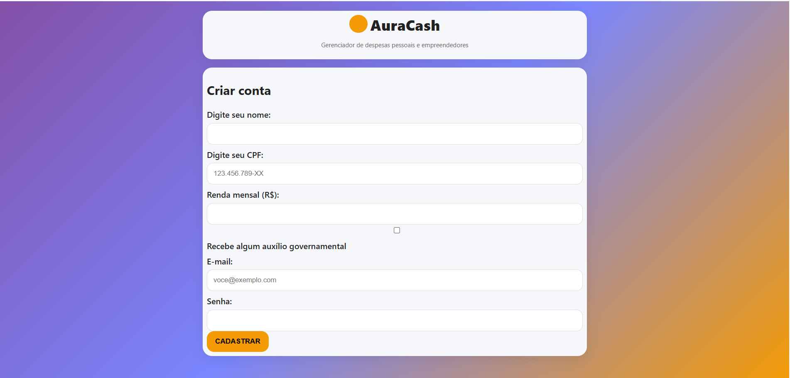

### 3. Dashboard

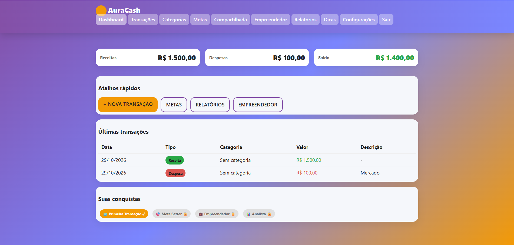

### 4. Transações

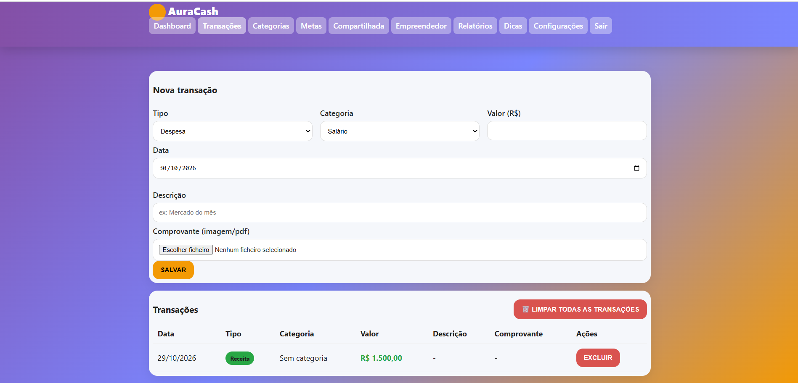

### 5. Categorias

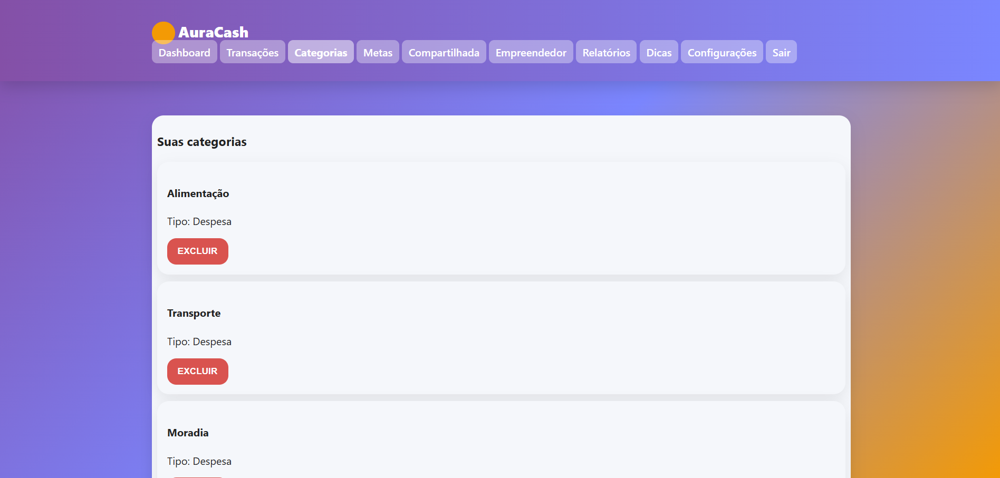

### 6. Adicionar categorias

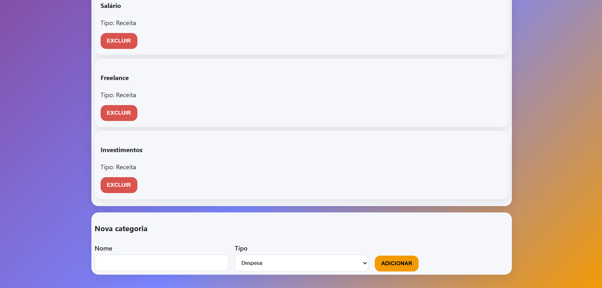

### 7. Metas

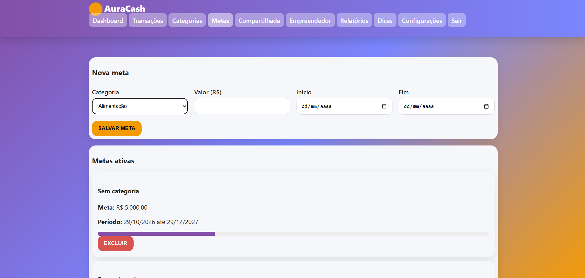

### 8. Conta compartilhada

### 9. Empreendedor

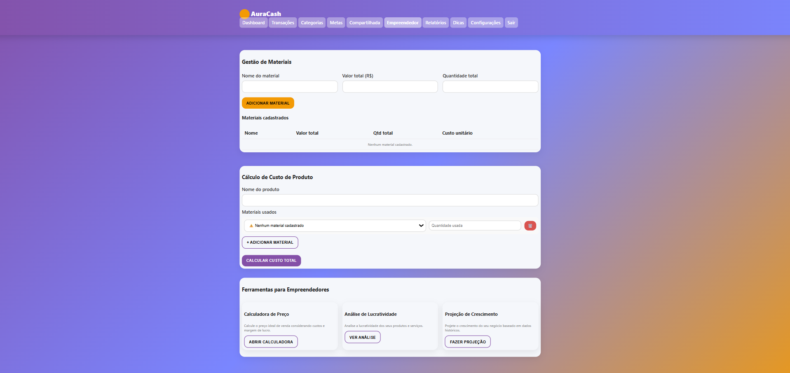

### 10. Relatórios

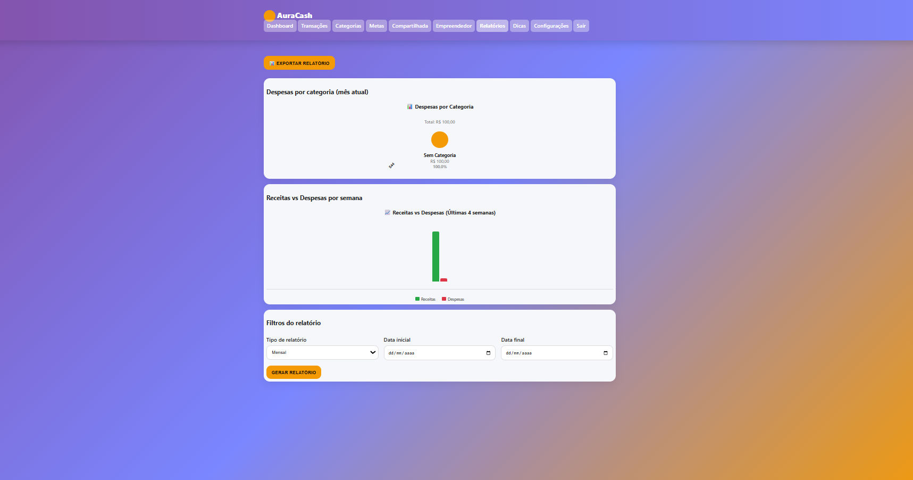

### 11. Dicas

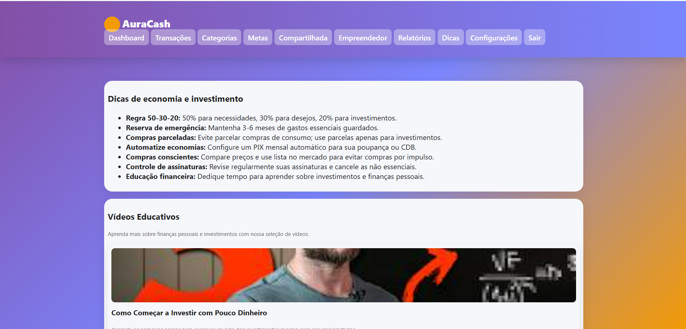

### 12. Configurações

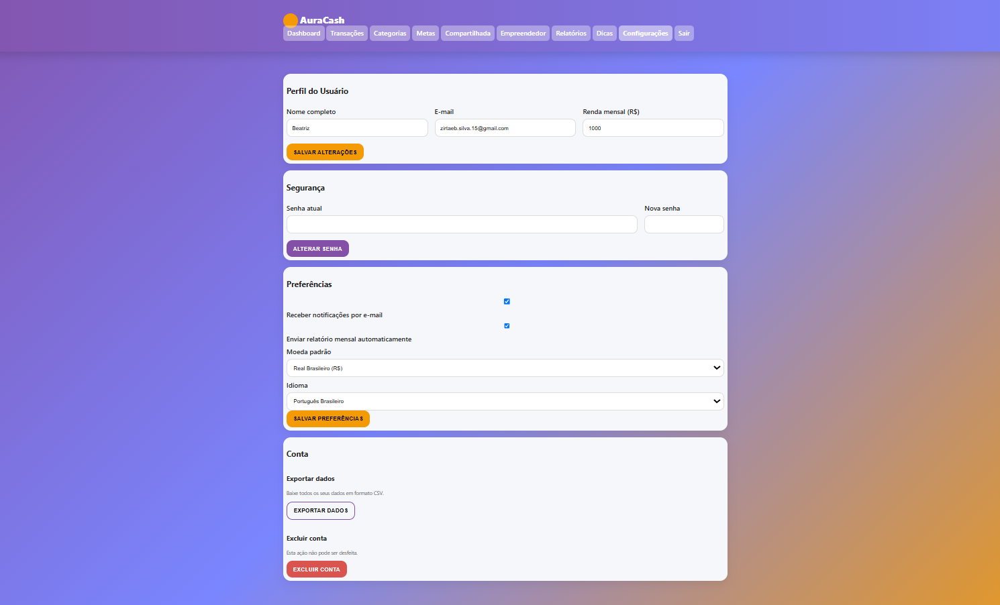
